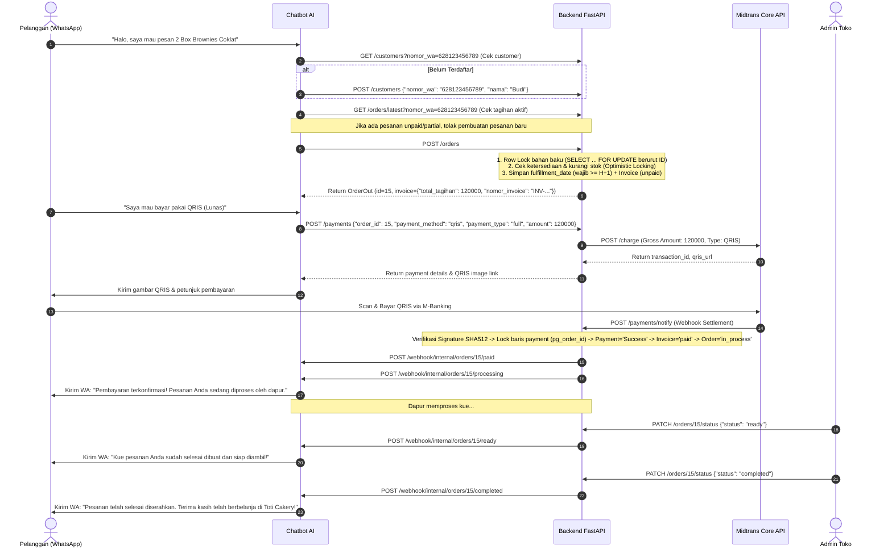
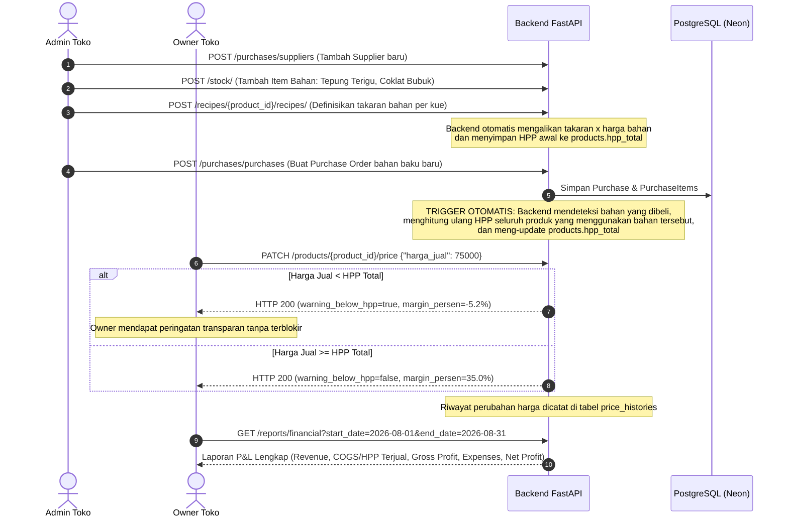

# End-to-End Workflow Scenarios

Dokumen ini mendeskripsikan skenario alur kerja dari hulu ke hilir (*User Journeys*), urutan pemanggilan API (*sequence of API calls*), penanganan *edge cases*, serta antisipasi skenario operasional masa depan di ekosistem **Toti Cakery**.

---

## 1. Skenario 1: Pembelian Pelanggan via Chatbot WhatsApp (*Conversational Commerce*)

### A. Alur Sukses (Happy Path)

### B. Alur Pembatalan Pesanan (Order Cancellation)
1. Pelanggan berubah pikiran sebelum membayar: `"Batalkan pesanan saya"`.
2. Chatbot memanggil `POST /orders/{order_id}/cancel` dengan header `X-Service-Key` (atau parameter `?service_key=...`).
3. Backend memvalidasi `invoice.status == 'unpaid'`.
4. Sistem menghitung seluruh bahan baku yang dialokasikan, lalu mengembalikan stok ke tabel `stock_items` dengan `version = version + 1`.
5. Status order menjadi `cancelled`.

### C. Alur Pembayaran Down Payment (DP 50%) & Pelunasan di Toko (Cash on Pickup)
1. **Pilihan DP 50%**: Pelanggan memilih pembayaran DP melalui Chatbot (`payment_type: "dp"`). Nilai tagihan divalidasi presisi tepat 50% dari total invoice.
2. **Settlement DP**: Setelah Midtrans mengirim webhook sukses:
   - Invoice berubah status menjadi `partial`.
   - Order bertransisi menjadi `in_process`.
   - Dihitung `settlement_due_date` (H-1 sebelum `fulfillment_date` pukul 18:00 WIB) untuk opsi pelunasan online.
3. **Fleksibilitas Pengambilan di Toko**:
   - Jika pelanggan memilih melunasi sisa tagihan 50% secara tunai/EDC langsung di toko fisik saat pengambilan kue:
   - Seller dapat memperbarui status pesanan menjadi `ready` dan `picked_up` tanpa diblokir oleh keharusan settlement online.
   - Sisa pembayaran dicatat langsung oleh kasir melalui `POST /payments/manual` (`method: "CASH"` / `"EDC"`).

### D. Pembacaan Status & Detail Pesanan oleh Chatbot via Service Key
1. Kapan pun Chatbot membutuhkan informasi komprehensif mengenai pesanan pelanggan (misalnya saat pelanggan menanyakan status kue):
2. Chatbot memanggil `GET /orders/{order_id}` menggunakan header `X-Service-Key` atau query parameter `?service_key=...` (menggunakan `SERVICE_ORDERS_READ_KEY` dengan scope `orders:read`).
3. Backend mengembalikan DTO `OrderOut` lengkap yang mencakup rincian item produk (`product_name`), invoice, metadata pembeli/pelanggan, `fulfillment_date`, dan status pembayaran terkini (`payment_status`).

---

## 2. Skenario 2: Registrasi & Login Pembeli via Buyer Site (*Zero-Cost OTP & Mock Testing*)

### A. Alur Registrasi Akun Pembeli Baru (Real Mode)
1. **Input Data**: Pembeli mengisi Form Register di website (Nama, Email, Nomor WhatsApp, Password).
2. **Start Verification**:
   - Web memanggil `POST /auth/verify/wa/start` dengan payload nomor telepon (mendukung lokal seperti `"08123456789"` maupun internasional seperti `"+1 (202) 555-0123"`).
   - Backend menormalkan nomor ke format E.164 (`"628123456789"`, `"12025550123"`), membuat `nonce` acak 6 digit (`"TR99KA"`), dan mengembalikan link `https://wa.me/<bot_no>?text=VERIFIKASI%20TR99KA`.
3. **Konfirmasi via Chatbot**:
   - Pembeli mengklik link dan mengirim pesan WhatsApp.
   - Chatbot menerima pesan dan memanggil `POST /auth/verify/wa/confirm` dengan `X-Service-Key` (menggunakan `SERVICE_WA_VERIFICATION_KEY` dengan scope `identity:verify`) atau `X-Internal-Key`.
   - Backend mencocokkan nomor pengirim (`sender_phone`) dengan nomor pendaftaran. Jika cocok, `otp.is_verified` diset `True` dan men-generate `verify_token` (UUID).
4. **Polling & Finalisasi Akun**:
   - Web mendeteksi status telah `verified` via `GET /auth/verify/wa/status?nonce=TR99KA`.
   - Web mengirimkan `POST /auth/buyer/register` menyertakan `verify_token`.
   - Backend memvalidasi dan mengonsumsi `verify_token` (single-use), meng-hash password dengan `bcrypt`, dan mengembalikan JWT Token pembeli (`role: "buyer"`).

### B. Alur Pengujian Cepat di Lingkungan Dev/Staging (Mock WA Mode)
1. Atur `.env`: `ENVIRONMENT=development` dan `WA_VERIFICATION_MODE=mock`.
2. Saat frontend memanggil `POST /auth/verify/wa/start`:
   - Backend langsung mem-bypass deep link WhatsApp, otomatis menandai OTP sebagai `is_verified = True`, men-generate `verify_token`, dan mengembalikan `{ "verify_token": "...", "mock_mode": true }`.
3. Frontend dapat langsung memanfaatkan `verify_token` tersebut untuk menyelesaikan registrasi atau login OTP tanpa perlu membuka WhatsApp.
4. *Catatan Keamanan*: Jika sistem dijalankan dengan `ENVIRONMENT=production` atau `APP_ENV=production`, backend secara otomatis memblokir Mock Mode dan memaksakan Real Mode.

### C. Transaksional Email Outbox & Ketahanan Startup SMTP
1. **Soft Warning Startup**: Di lingkungan `ENVIRONMENT=production` atau `APP_ENV=production`, ketiadaan variabel SMTP tidak lagi membuat aplikasi crash saat start (`ValueError`), melainkan diturunkan menjadi *soft warning log*. Hal ini memungkinkan staging dan sandbox environment berjalan tanpa hambatan.
2. **Atomic Outbox Worker**: Worker pengirim email menggunakan transaksi sewa atomik `SELECT ... FOR UPDATE SKIP LOCKED` sehingga aman dijalankan pada arsitektur multi-replica tanpa risiko mengirim email duplikat kepada pengguna.

---

## 3. Skenario 3: Manajemen Inventori, Resep (BOM), Pengadaan & Laporan Finansial

### A. Pengadaan Bahan Baku & Cascading HPP Update

### B. Audit Ledger Stok & Penjagaan Saldo Negatif
1. **Validasi Bilangan Riil Terbatas (Finite Numbers)**: Setiap penyesuaian stok manual via `POST /stock/{stock_id}/adjustments` memvalidasi `quantity_difference` dan `unit_cost` agar terhindar dari input berbahaya seperti `NaN` atau `Infinity`.
2. **Pencegahan Saldo Negatif**: Sistem menolak pengurangan stok jika saldo akhir akan turun di bawah 0.
3. **Standarisasi Constraint Default**: Nilai `alert_min_stok` secara konsisten diberi default `Decimal("0.00")` pada pembuatan maupun pembaruan master material.

### C. Ringkasan Finansial untuk Chatbot via Service Key
1. Chatbot dapat meminta ringkasan finansial harian/bulanan melalui `GET /reports/financial-summary` dengan header `X-Service-Key` atau `?service_key=...` (menggunakan `SERVICE_FINANCIAL_SUMMARY_KEY` dengan scope `reports:summary`).
2. API mengembalikan metrik instan: omzet kotor, modal HPP, laba kotor, persentase margin, total order, dan Average Order Value (AOV).

---

## 4. Skenario 4: Eskalasi Live-Chat Human Takeover

### A. Alur Kerja Pengalihan Percakapan dari AI ke Admin
1. **Deteksi Pesanan Khusus**:
   Pelanggan meminta kue pernikahan dengan dekorasi kustom yang tidak dapat ditangani otomatis oleh AI.
2. **Pengecekan Handler Admin**:
   Chatbot memanggil `GET /admin/takeover-handlers` (Header `X-Service-Key` atau `?service_key=...`) untuk mendapatkan daftar nomor WhatsApp admin yang bertugas: `{"numbers": ["628123456789", ...]}`.
3. **Notifikasi ke Admin**:
   Chatbot mengirimkan pesan notifikasi ke WhatsApp admin yang bertugas:
   > *"🚨 Ada permintaan kue custom dari pelanggan Budi (628123456789). Silakan ambil alih percakapan."*
4. **Aktivasi Takeover**:
   Admin mengaktifkan takeover via Admin Site atau endpoint `POST /customers/{nomor_wa}/takeover` dengan parameter `active=true` dan `expires_at` (misal: 2 jam ke depan).
5. **Bypass Chatbot**:
   Setiap kali customer mengirim pesan, Chatbot memanggil `GET /customers/{nomor_wa}/takeover`. Karena `human_takeover_active = True` dan belum kedaluwarsa, chatbot **tetap hening** (tidak membalas pesan).
6. **Fallback Otomatis**:
   Setelah waktu `expires_at` terlewati, pengecekan `is_expired` bernilai `True`. Kontrol percakapan secara otomatis kembali ke Chatbot AI tanpa perlu admin menonaktifkannya secara manual.

---

## 5. Penanganan Edge Cases & Keamanan Data (*Concurrency & Resilience*)

| Skenario Edge Case | Potensi Masalah | Solusi & Mekanisme Backend |
| :--- | :--- | :--- |
| **Dua Customer Checkout Bahan Terakhir Bersamaan** | Race Condition & Overselling bahan baku | **Pessimistic Row Lock + Optimistic Locking**: Sistem mengunci baris stok bahan (`SELECT ... FOR UPDATE` terurut berdasarkan ID bahan) untuk mencegah race condition, dilanjutkan pengecekan saldo dan pengurangan stok dengan Optimistic Locking (`version = version + 1`) serta auto-retry 3x. Menjamin 0% risiko overselling. |
| **Webhook Callback Simultan (Double Settlement)** | Double-processing, akumulasi pembayaran berlebih | **Row-Level Lock & Idempotency Guard**: Query `SELECT ... FOR UPDATE` langsung mencari `Payment.pg_order_id == order_id` sebelum fallback ke nomor invoice. Transaksi yang sudah terminal (`Success`) langsung di-skip secara idempoten tanpa duplikasi pembaruan status order. |
| **Webhook Terlambat (Stale Webhook Rollback)** | Status `Success` tertimpa kembali menjadi `Pending` | **State Machine Transition Guard**: `is_valid_payment_transition` memblokir backward transition sehingga status terminal tidak dapat diubah oleh webhook yang terlambat. |
| **Pengambilan Pesanan DP di Toko (Store Pickup)** | Pesanan DP terblokir tidak bisa diserahkan karena belum lunas online | **Store Pickup Transition Support**: State machine membolehkan pesanan berstatus pembayaran DP (`partial`) untuk ditransisikan ke `ready` dan `picked_up` tanpa memaksakan pelunasan online di muka, memungkinkan pelunasan tunai/EDC di kasir toko fisik. |
| **Input Nilai Stok Anomali / Non-Finite (NaN / Inf)** | Database corrupt atau kalkulasi HPP hancur | **Finite Quantity & Non-Negative Inventory Guard**: Penyesuaian stok memvalidasi bahwa selisih kuantitas dan harga satuan bernilai terhingga (`is_finite()`), serta menolak mutasi yang menyebabkan saldo stok di bawah nol. |
| **Multi-Replica Email Worker Race Condition** | Pelanggan menerima email ganda | **Atomic Outbox Leasing (Skip Locked)**: Worker email menggunakan query atomik `SELECT ... FOR UPDATE SKIP LOCKED` dengan masa sewa waktu (`leased_at`, `lease_expires_at`), mencegah dispatcing email ganda pada infrastruktur multi-kontainer. |
| **Startup Crash Karena SMTP Belum Dikonfigurasi** | Kontainer backend gagal booting di staging/lab | **Production Soft-Warning Graceful Degradation**: Pada mode produksi/staging (`APP_ENV=production`), absennya kredensial SMTP tidak lagi melempar `ValueError` fatal, melainkan mencatat *soft warning log*. |
| **Pembatalan Pesanan Simultan (Double Cancellation)** | Restorasi stok bahan baku ganda | **Pessimistic Order Lock**: `update_order_status` dan `cancel_order_by_customer` menggunakan `with_for_update()` dan validasi `is_valid_order_transition`. |
| **Manipulasi Nominal Pembayaran (Tampering)** | Pelanggan mengubah nominal tagihan di payload | **Anti-Tampering Validation**: Backend menghitung ulang nilai eksak (Full $100\%$ atau DP $50\%$) dan membandingkannya hingga tingkat desimal `0.01` sebelum meneruskan ke Midtrans. |
| **Spam / Salah Nomor Verifikasi WA** | Brute force verifikasi nonce | **Rate Limiting Counter**: Kolom `otp_codes.attempt_count` mencatat percobaan salah pengirim ($\ge 3$ blokir) + SlowAPI rate limit 6 req/min. |
| **Spam Checkout & Brute Force Login** | Pengurasan stok inventori & pembajakan akun | **SlowAPI In-Memory Rate Limiting**: Pembatasan 5 req/min pada pembuatan order dan 10 req/min pada login/register menghasilkan HTTP `429 Too Many Requests`. |
| **Webhook Callback Palsu / Man-in-the-Middle** | Status pesanan diubah jadi lunas secara ilegal | **SHA-512 Signature Hash**: Backend memverifikasi `SHA512(order_id + status_code + gross_amount + server_key)` sebelum memproses transaksi. |
| **Perubahan Harga Bahan Baku Global** | HPP produk menjadi kadaluwarsa (*stale*) | **Cascading BOM Sync**: Trigger otomatis pada service purchasing dan recipe langsung mengkalkulasi ulang HPP seluruh produk terkait. |
